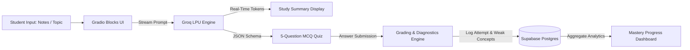

# 🎓 StudyBuddy AI

> **High-Yield Exam Companion • Instant Revision Summaries, Practice Quizzes & Weak-Topic Tracking**  
> *Built for Hackathons • Education & AI for Learning Track*

---

## 📌 Problem & Pitch

Students cramming for exams drown in hundreds of pages of unstructured notes and textbook slides. Passive reading yields less than **20% long-term retention**, while manual flashcard and quiz creation takes hours.

**StudyBuddy** solves this in under 5 seconds:
1. **Synthesizes** raw notes or a topic into an executive summary with core concepts, memory hooks, and common exam traps.
2. **Generates** a 5-question multiple-choice quiz designed specifically for active recall.
3. **Diagnoses & Tracks** missed concepts over time in Supabase to give students a personal weakness roadmap.

---

## 🚀 Core Features

- ⚡ **Instant Streaming Summaries**: Real-time token streaming powered by Groq's high-speed LPU inference engine.
- 🎯 **5-Question Practice Quiz**: Context-aware multiple-choice questions with 4 distinct options, distractors, and concept tags.
- 📝 **Diagnostic Grading & Explanations**: Immediate feedback explaining *why* an answer is correct or incorrect.
- 📊 **Progress & Weak-Topics Tab**: Automatically tracks quiz scores in Supabase and surfaces recurring weak concepts.
- 📥 **One-Click Downloadable Study Guide**: Export complete study notes and quizzes as clean Markdown (`.md`).
- 🛡️ **Zero-Crash Resiliency**: Includes an in-memory session fallback so the app functions 100% smoothly even when offline or before database setup.

---

## 🛠️ Tech Stack

| Component | Technology | Description |
| :--- | :--- | :--- |
| **Language** | Python 3.11+ | Modern, async-ready Python backend |
| **LLM Inference** | **Groq SDK** | Ultra-low latency LPU engine (`openai/gpt-oss-120b` / `llama-3.3-70b-versatile`) |
| **Frontend UI** | **Gradio (`gr.Blocks`)** | Reactive, mobile-friendly interface with custom Soft theme |
| **Server / API** | **FastAPI** | ASGI container hosting mounted Gradio app (`api/index.py`) |
| **Database** | **Supabase** | Managed PostgreSQL with Row-Level Security (RLS) policies |
| **Deployment** | **Vercel / HF Spaces** | Deployable to Vercel Serverless or persistent Docker/Hugging Face Spaces |

---

## 🏗️ Architecture

---
